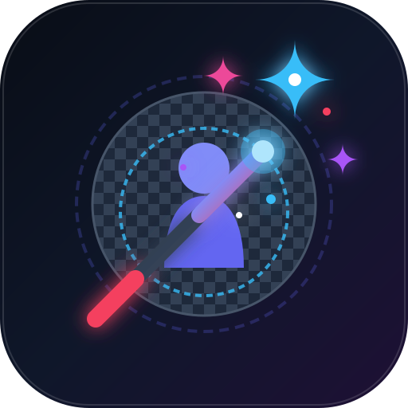

# ClearCut STUDIO 🪄✂️

<p align="center">
  
</p>

<p align="center">
  <strong>The 100% Private, Client-Side AI Background Remover, Touch-Up Canvas & Icon Studio.</strong>
  <br />
  <em>Zero cloud uploads. Zero subscriptions. Zero latency. Runs entirely in your browser — even offline.</em>
</p>

<p align="center">
  
  
  
  
  
  
</p>

---

## 🌟 Why ClearCut STUDIO?

Most background removal tools upload your sensitive photos to remote cloud servers, enforce monthly paywalls, or downscale your exports. 

**ClearCut STUDIO** is an open-source, client-first Progressive Web App (PWA) designed for designers, developers, and everyday creators who want **instant, unlimited background removal with zero telemetry and total privacy**. Powered by modern neural networks compiled to WebAssembly and WebGPU, everything happens locally on your CPU or GPU.

---

## ✨ Features at a Glance

### 🧠 100% Private, On-Device AI
- **Dual Neural Engines**:
  - **Full Precision (FP16)**: High-precision edge matting for hair, fur, and intricate glass transparency.
  - **Fast / Low-RAM (UINT8)**: Quantized weights (~40MB) delivering 2× faster inference with ultra-low memory overhead on mobile and low-spec machines.
- **Hardware Acceleration**: Automatically taps into **WebGPU** with seamless automatic fallback to SIMD-threaded **WASM (CPU)**.
- **Zero Cloud Leakage**: Your photos, masks, and exports never touch an external server. Disconnect your Wi-Fi and it still works flawlessly.

### 🎨 Precision Touch-Up & Selection Tools
- **Left Bump-Out Toolbar**:
  - **Smart Erase & Restore Brushes**: Hand-tune AI cutouts or recover accidentally clipped elements.
  - **Fluid Gestural Drag Adjustments**: Drag vertically to adjust brush radius; drag horizontally to dial in brush hardness/softness in real time.
- **Right Bump-Out Selection Suite**:
  - **Magic Wand with Tolerance Control**: Select contiguous color regions.
  - **Lasso & Polygonal Tools**: Trace custom silhouettes with sub-pixel accuracy.
  - **Rectangular & Elliptical Marquee**: Quick geometry cuts.
  - **Feather & Invert**: Soften mask borders or flip selections instantly.

### 🎬 Sprite Slideshow Player & Frame Animator
- Step through sprite frames or multi-angle cutout sheets.
- **Batch "Capture All Frames"**:
  - Export zipped bundles of isolated PNG or WebP frames plus sprite sheet strips.
  - Live **Donut Progress Meter** tracking render and zip compression.
  - Adjustable WebP compression quality presets (Standard, High, Lossless/Max).

### 🪟 Windows `.ICO` Multi-Resolution Generator
- Generate true multi-frame `.ico` files containing embedded 16×16, 32×32, 48×48, 64×64, 128×128, and 256×256 MIP resolutions in a single file.

### 📐 Studio Crop & Canvas Geometry
- Lock aspect ratios: `1:1`, `4:3`, `16:9`, `3:2`, `9:16`, or freeform.
- Rotation (90° increments) and mirror flipping (Horizontal & Vertical).
- Exact pixel dimension rescaling with bicubic resampling.

### 🪞 Before & After Split Wipe
- Real-time interactive divider slider to compare the raw source image against the refined cutout.
- **Multi-Backdrop Preview Deck**:
  - Dark Checkerboard (Default)
  - Light Checkerboard
  - Pure Studio White
  - Deep Obsidian Black
  - Custom Vibrant Chroma (Green screen, Blue screen, Custom hex)

### 📲 Desktop & Mobile PWA Ready
- Install directly from Chrome, Edge, Safari (iOS / macOS), or Android.
- Launches full-screen without URL bars, equipped with dedicated system app icons, offline caching, and responsive touch layout.

---

## ⚡ Quick Start

### Prerequisites
- [Node.js](https://nodejs.org/) (v18.0.0 or higher)
- npm or pnpm

### 1. Clone the repository
```bash
git clone https://github.com/your-username/clearcut-studio.git
cd clearcut-studio
```

### 2. Install dependencies
```bash
npm install
```

### 3. Launch the development server
```bash
npm run dev
```
Open [http://localhost:3000](http://localhost:3000) in your browser.

---

## 🏗️ Production Build & Verification

```bash
# Type check and build static production bundle with PWA service worker
npm run build

# Preview the production build locally
npm run preview

# Run TypeScript linting check
npm run lint
```

---

## ⌨️ Shortcuts & Hotkeys

| Action | Shortcut |
| :--- | :--- |
| **Open Native File Picker** | Click **Open Image** or Press `O` |
| **Paste Image from Clipboard** | `Ctrl + V` / `⌘ + V` |
| **Undo Canvas Action** | `Ctrl + Z` / `⌘ + Z` |
| **Redo Canvas Action** | `Ctrl + Y` / `⌘ + Shift + Z` |
| **Zoom In / Out** | `+` / `-` or `Mouse Wheel` |
| **Pan Workspace** | `Spacebar + Drag` or `Middle Mouse Drag` |
| **Reset Zoom / Fit Canvas** | `Ctrl + 0` / `⌘ + 0` |
| **Close Open Modal** | `Escape` |

---

## 🌐 Deploy to GitHub Pages (Automated)

This repository includes a ready-to-run GitHub Actions workflow (`.github/workflows/deploy.yml`):

1. Fork or push this repository to GitHub.
2. In your GitHub repo, navigate to **Settings** → **Pages**.
3. Under **Build and deployment** → **Source**, select **GitHub Actions**.
4. Every push to the `main` branch will automatically build, optimize, and deploy your live applet with working PWA service workers!

---

## 🧰 Technology Architecture

- **UI & Architecture**: [React 19](https://react.dev/), [TypeScript](https://www.typescriptlang.org/)
- **Bundler & PWA Engine**: [Vite](https://vitejs.dev/) with [`vite-plugin-pwa`](https://vite-pwa-org.netlify.app/) & [Workbox](https://developer.chrome.com/docs/workbox)
- **Styling**: [Tailwind CSS](https://tailwindcss.com/)
- **Client AI Matting**: [`@imgly/background-removal`](https://github.com/imgly/background-removal-js) via ONNX Runtime Web
- **Archive & Asset Processing**: [JSZip](https://stuk.github.io/jszip/), Resvg
- **Icons & Visuals**: [Lucide React](https://lucide.dev/)

---

## 🔒 Privacy Guarantee

> ClearCut STUDIO does not collect telemetry, analytics, session recordings, or image data. All neural inference, canvas manipulations, and file exports are executed strictly on your local device.

---

## 📄 License

Distributed under the **Apache-2.0** License. See `LICENSE` for details.
